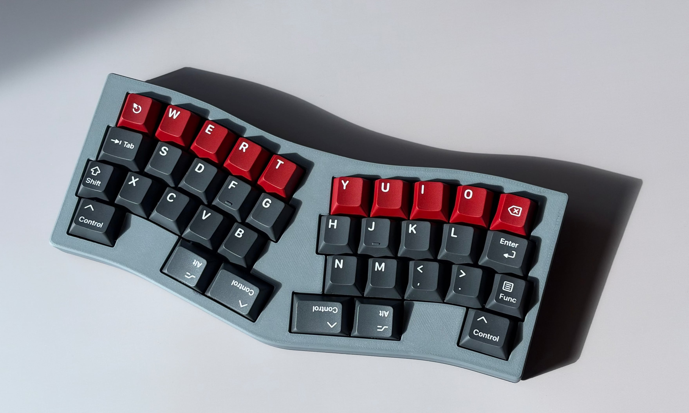

# Caroline

Caroline is a 36-key unibody split electrostatic capacitive (EC) keyboard featuring Direct EC: the key matrix is read directly by the microcontroller's ADC, without using any external components.

> Her name is Caroline. Remember that!

> [!WARNING]
> This is a work in progress.

## Design

- Minimal BOM EC sensing: no mux, op-amp, integrator cap, no nothing
- 36-key Treadstone staggered layout with QAZlice characteristics
- Seeed Studio XIAO **Plus** controller on ZMK firmware
    - nRF52840 Plus for wireless, SAMD21 Plus or RP2040 Plus for wired
- Low-power wireless with nRF52840
    - Over a month of battery life on 100 mAh, a fraction of the power draw of other wireless EC keyboards
    - Idle scan draws under 30µA, always ready to type with no wake-up delay
- Plate designed for Deskeys (DES) housings

## Direct EC

## Files

- [`caroline-pcb/`](caroline-pcb/): KiCad project
    - [View the PCB on KiCanvas](https://kicanvas.org/?github=https%3A%2F%2Fgithub.com%2Fcarrefinho%2Fcaroline%2Ftree%2Fmain%2Fcaroline-pcb)
- [`ergogen/`](ergogen/): Ergogen config that generates key positions and reference outlines
- [`tools/`](tools/): helper scripts
    - [`pick_screws.py`](tools/pick_screws.py): picks optimal screw pattern for an even clamp (see [`caroline-pcb/`](caroline-pcb/README.md#screw-holes))

## Build Guide

## Firmware

## Credits

- [dohn-joh/heatwave](https://github.com/dohn-joh/heatwave): layout, aesthetics, ergogen reference
- [apfel/daertwing](https://git.clacktal.es/apfel/daertwing/): layout reference
- [Madeline](https://40s.wiki/boards/madeline): aesthetics
- [Marbelymarble/Adalyn](https://github.com/Marbelymarble/Adalyn): layout reference for early experiments

## License

[CERN-OHL-P v2](LICENSE)
